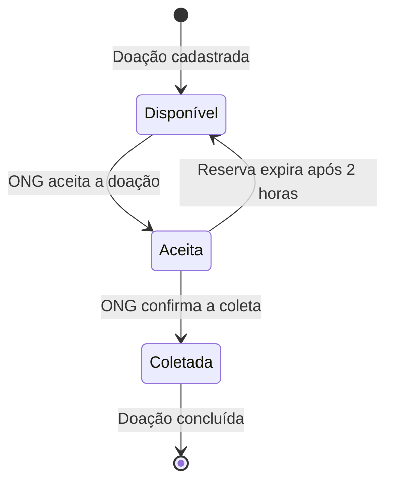

# Diagrama de Estados — Versão Inicial

**Projeto:** Prato Cheio

**Responsável:** Henrique Cordeiro de Oliveira

**Ferramenta de IA:** ChatGPT

## Objetivo

Representar o ciclo de vida de uma doação de alimentos,
desde seu cadastro até a confirmação da coleta,
considerando também a expiração de reservas.

## Diagrama inicial

## Descrição inicial

O diagrama representa três estados principais:

1. **Disponível:** a doação foi cadastrada e pode ser aceita por uma ONG.

2. **Aceita:** uma ONG aceitou a doação, reservando o alimento para retirada.

3. **Coletada:** a ONG confirmou que realizou a retirada.

O modelo também considera que uma reserva pode expirar
após duas horas, permitindo que a doação volte
ao estado disponível.

## Observação

Esta é a primeira versão produzida com auxílio de
Inteligência Artificial.

O modelo ainda não foi confrontado com o código-fonte,
os testes automatizados ou as decisões de arquitetura.

Ele será analisado criticamente e aprimorado em uma
segunda versão.