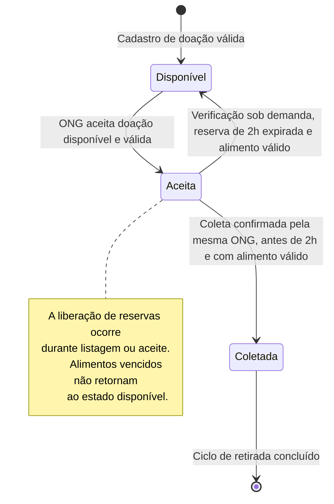

# Diagrama de Estados — Versão Final

**Projeto:** Prato Cheio

**Responsável:** Henrique Cordeiro de Oliveira

**Ferramenta de IA:** ChatGPT

## Objetivo

Representar os estados reais das doações e suas transições,
considerando as regras implementadas no PostgreSQL.

## Diagrama final revisado

## Estados existentes no banco

O PostgreSQL utiliza somente três valores para o campo status:

- `disponivel`: doação cadastrada, ainda não aceita.
- `aceita`: doação reservada por uma ONG.
- `coletada`: retirada confirmada.

## Correções realizadas após a análise do código

### 1. Expiração da reserva

**Versão inicial:** indicava que a doação retornaria ao estado
disponível após duas horas, sem explicar quando a verificação ocorria.

**Versão final:** esclarece que a liberação acontece sob demanda,
durante a listagem de doações ou uma nova tentativa de aceite.

Essa regra foi verificada em `src/doacoes.js` e `src/repositorio.js`.

### 2. Validade do alimento

**Versão inicial:** não indicava a necessidade de verificar
a validade do alimento antes de disponibilizá-lo novamente.

**Versão final:** a doação somente retorna ao estado disponível
quando a reserva expirou e o alimento continua válido.

### 3. Confirmação da coleta

**Versão inicial:** apresentava a transição de aceita para coletada
sem detalhar suas condições.

**Versão final:** representa que a coleta exige a mesma ONG
responsável, reserva ainda válida e alimento dentro da validade.

## Decisões técnicas

A implementação não utiliza um agendador independente
para expirar reservas.

Também não utiliza os status `reservada` ou `expirada`
no banco de dados.

Uma doação coletada não retorna ao estado disponível.

## Arquivos utilizados na validação

- `src/db.js`
- `src/repositorio.js`
- `src/doacoes.js`
- `docs/adr/0002-expiracao-sob-demanda.md`

## Conclusão

O diagrama final foi revisado com base na implementação real.

Ele representa o ciclo de vida das doações e as condições
necessárias para aceitar, liberar reservas e confirmar coletas.