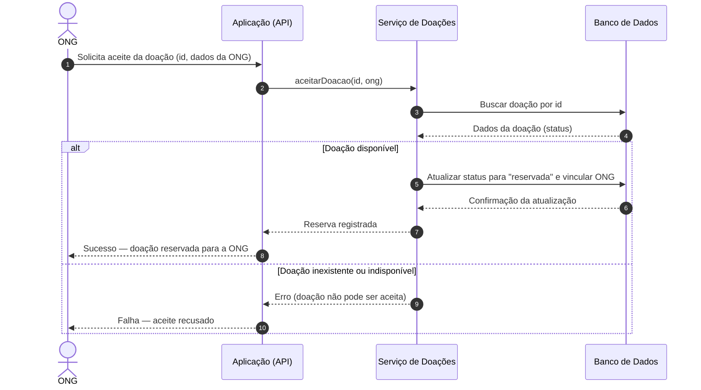

# Diagrama de Sequência — Aceite de doação (versão inicial)

> Versão inicial gerada com IA a partir apenas da descrição de alto nível do fluxo,
> sem consulta ao código. Preservada sem correções para a análise crítica.

**Descrição usada:** a ONG pede para aceitar uma doação, a aplicação registra a
reserva e responde com sucesso ou falha.

## Explicação breve

1. A ONG envia à API o pedido de aceite de uma doação.
2. A API repassa o pedido para a camada de serviço, que concentra a regra de negócio.
3. O serviço consulta a doação no banco para conferir se ela ainda está disponível.
4. Se estiver disponível, o serviço muda a doação para reservada, registra a ONG
   responsável e a API responde com sucesso.
5. Se a doação não existir ou já tiver sido aceita, a API responde com falha.
