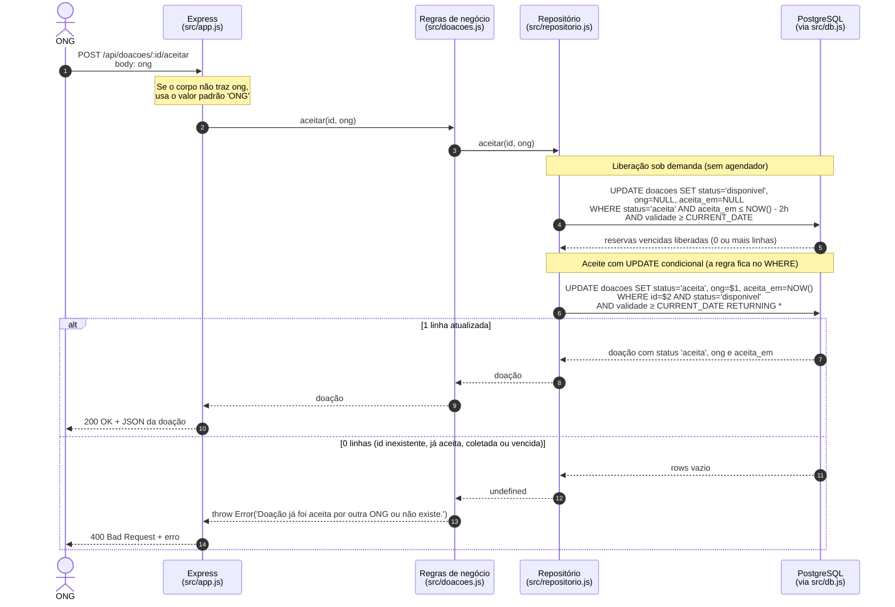
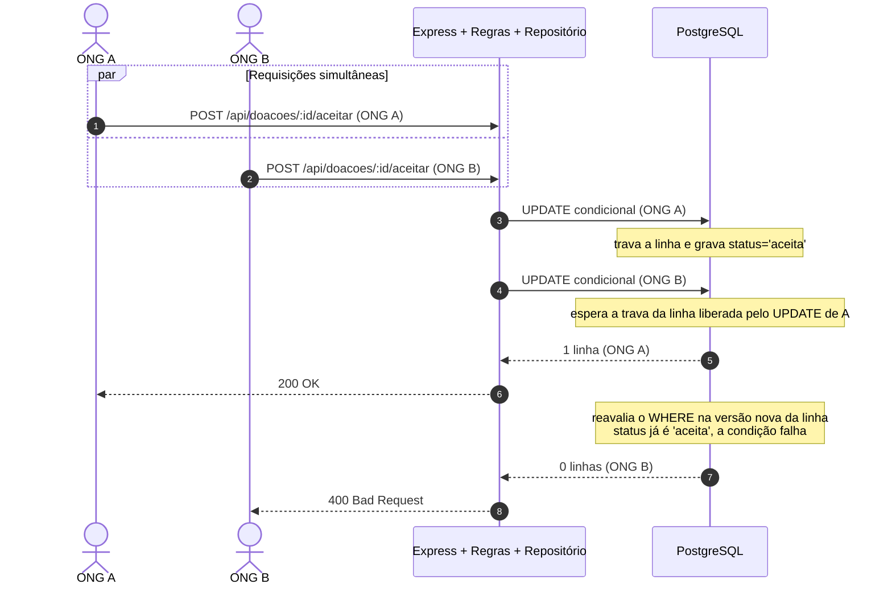

# Diagrama de Sequência — Aceite de doação (versão final)

> Versão revisada a partir da [versão inicial](03-sequencia-inicial.md), conferida
> com o código real da branch `entrega-2`: [`src/app.js`](../../src/app.js),
> [`src/doacoes.js`](../../src/doacoes.js), [`src/repositorio.js`](../../src/repositorio.js),
> [`src/db.js`](../../src/db.js) e os ADRs
> [0001](../adr/0001-migracao-para-postgresql.md) e [0002](../adr/0002-expiracao-sob-demanda.md).

## 1. Fluxo de uma requisição de aceite

## 2. Aceite concorrente (duas ONGs ao mesmo tempo)

O controle de concorrência é do próprio PostgreSQL. O código não tem fila,
`SELECT ... FOR UPDATE` nem transação explícita. Cada `UPDATE` roda sozinho em
uma conexão do pool e trava a linha que altera.

A ordem entre A e B não é fixa: qualquer uma das duas pode vencer. Duas coisas
são garantidas: exatamente uma ONG recebe 200 e a outra recebe 400.

## 3. Diferenças encontradas na versão inicial

Todas foram conferidas no código. A versão inicial não foi alterada.

| # | Versão inicial | Código real | Evidência |
|---|---|---|---|
| 1 | Muda o status para `"reservada"` | Esse status não existe. O aceite grava `status = 'aceita'`, e o `CHECK` só permite `disponivel`, `aceita` e `coletada` | `src/db.js` (CHECK), `src/repositorio.js` função `aceitar` |
| 2 | Primeiro busca a doação (`SELECT`), depois o serviço decide e faz o `UPDATE` | Não há leitura antes. Um único `UPDATE ... WHERE id = $2 AND status = 'disponivel' AND validade >= CURRENT_DATE RETURNING *` decide e grava ao mesmo tempo | `src/repositorio.js`, função `aceitar` |
| 3 | Sem liberação de reservas vencidas | Antes do aceite, `liberarReservasExpiradas()` devolve para `disponivel` as reservas com 2 h ou mais, desde que o alimento ainda esteja na validade | `src/repositorio.js`, ADR 0002 |
| 4 | Não confere a validade nem registra o horário | O `WHERE` exige `validade >= CURRENT_DATE` e o `SET` grava `aceita_em = NOW()` | `src/repositorio.js` |
| 5 | Camadas genéricas ("API", "Serviço", "Banco"), sem repositório | Quatro camadas: Express → `doacoes.js` → `repositorio.js` → PostgreSQL | `src/app.js`, `src/doacoes.js` |
| 6 | Resposta genérica ("Sucesso"/"Falha") | `POST /api/doacoes/:id/aceitar` responde `200` com a doação ou `400` com `{ erro }` | `src/app.js` |

O item 2 é o mais importante. No modelo inicial, duas ONGs podiam ler
"disponível" ao mesmo tempo e as duas gravarem o aceite (*check-then-act*). O
código real não tem essa falha porque a verificação fica dentro do próprio
`UPDATE`.

O modelo inicial acertou em representar os dois desfechos (sucesso e falha) e em
deixar a regra de negócio fora da camada HTTP.

Há um detalhe que vale citar, sem ser erro do diagrama: o aceite **não exige**
o nome da ONG. Se `ong` não vier no corpo, `src/app.js` grava `'ONG'`. Já a
coleta valida o nome (ADR 0002, "Identificação das ONGs").

## 4. Por que o PostgreSQL e o UPDATE condicional importam

- **SQLite → PostgreSQL** ([ADR 0001](../adr/0001-migracao-para-postgresql.md)):
  o SQLite trava o banco inteiro a cada escrita e só serve a um processo. O
  PostgreSQL trava apenas a linha alterada, aceita várias conexões (o `pg.Pool`
  de `src/db.js`) e tem tipos fortes (`DATE`, `TIMESTAMPTZ`, `CHECK`). Sem
  `TIMESTAMPTZ` não seria possível guardar `aceita_em` com segurança, e a regra
  das 2 horas depende disso.
- **UPDATE condicional:** juntar verificação e escrita em um só comando torna o
  aceite atômico. Quem chega em segundo espera a trava da linha e, no nível de
  isolamento padrão (*READ COMMITTED*), o PostgreSQL reavalia o `WHERE` na
  versão já atualizada. A condição `status = 'disponivel'` deixa de valer, nenhuma
  linha é alterada, e `doacoes.js` transforma essa ausência em erro 400.
  Bloqueios na aplicação ou filas não seriam necessários, e não existem no código.

## 5. Como conferir em `tests/doacoes.test.js`

| O que o diagrama afirma | Teste |
|---|---|
| 200 com `status = 'aceita'` e `ong` gravada | `marca a doação como aceita pela ONG` |
| 400 quando a doação já foi aceita | `recusa aceitar uma doação que já foi aceita por outra ONG` |
| Concorrência: um 200 e um 400 | `aceita a doação uma única vez quando duas ONGs aceitam ao mesmo tempo` |
| `aceita_em` preenchido no aceite | `registra o horário quando a ONG aceita uma doação` |
| Liberação sob demanda e depois um único novo aceite | `permite apenas um novo aceite após a reserva expirar` |
| Alimento vencido não volta a ficar disponível | `não disponibiliza novamente uma doação vencida` |
| O banco recusa status fora do fluxo (`CHECK`) | `o banco recusa um status fora do fluxo` |

Para rodar: `npm test`, com `DATABASE_URL_TESTE` apontando para um banco
PostgreSQL de testes (ver `README.md` do projeto).
